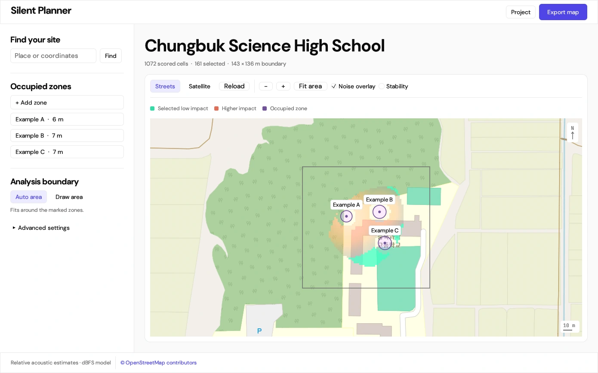
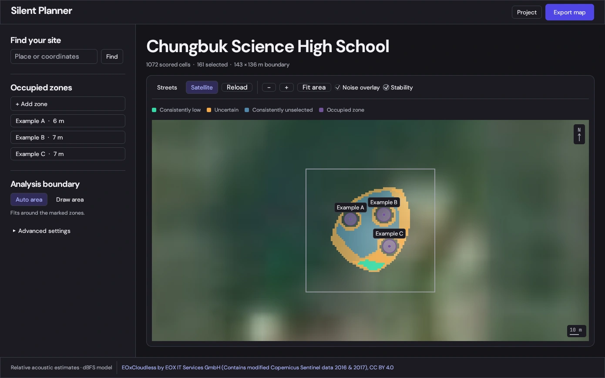

# Silent Planner

A Rust desktop app for exploring how the placement of an outdoor drone experiment could affect occupied areas. Mark receiver zones on a real map, compare relative acoustic scores, test how sensitive the ranking is to your assumptions, and export the analysis for field measurement planning.



*Desktop screenshot of the built-in Chungbuk Science High School example. The map uses the school's public map pin. The three labeled receiver zones are illustrations. Street map © [OpenStreetMap contributors](https://www.openstreetmap.org/copyright).*

## Quick Start

From the repository root, build and run the native app with Rust and Cargo:

```bash
cargo run --locked --manifest-path planner/Cargo.toml --release
```

1. Search for a place or enter latitude and longitude, or start with the built-in Chungbuk Science High School example.
2. Add the places where people are, adjust each zone's radius and sensitivity, then choose **Auto area** or draw an analysis boundary.
3. Switch between **Streets** and **Satellite**. Enable **Noise overlay** for relative impact and **Stability** to see which low-score areas persist across changes to radius, sensitivity and grid spacing.
4. Select **Export map** to save a printable SVG, grid CSV, analysis and project JSON, sensitivity results, candidate pairs for field measurement and, for a georeferenced project, GeoJSON.

[Desktop setup, basemap details and export reference](planner/README.md) · [School location](https://school.cbe.go.kr/cbs-h/M010205/)

<details>
<summary>Dark appearance, satellite view and stability overlay</summary>



*Actual desktop capture. Green cells remain low across the tested assumptions, amber cells have uncertain rankings, and blue cells were consistently unselected. [EOxCloudless](https://cloudless.eox.at) by [EOX IT Services GmbH](https://eox.at) (Contains modified Copernicus Sentinel data 2016 &amp; 2017), [CC BY 4.0](https://creativecommons.org/licenses/by/4.0/).*

</details>

## Project Overview

The desktop app implements map interaction, scoring and exports in Rust. The Python research pipeline predicts historical digital recording levels from nominal source–receiver geometry and outdoor scene, compares regression models on held-out acquisition batches, and simulates fictional receiver zones.

## Research Motivation

Classrooms, libraries and laboratories have different needs for quiet. A school can measure its existing background environment and use a separate research model to explore how outdoor source–receiver geometry relates to recorded level. This motivates where to collect follow-up measurements.

## Problem Definition

Predict one full-recording RMS level in decibels relative to digital full scale (dBFS) for channel 0 of a hovering DJI Flip recording. Inputs are log10 slant distance, nominal height and outdoor scene type. The response includes concurrent background sound and recorder effects.

## System Architecture

```text
Official Zenodo ZIP64 ranges -> verified original WAV and CSV files
  -> recording-level table and quality audit -> batch-grouped train/validation/test
  -> saved regressors -> held-out diagnostics -> fictional school receiver scenarios

School background CSV -> validation -> independent background summaries
```

## Dataset Sources

The selected source is [Wang, Chen, Chen and Liu, v1.1.0](https://doi.org/10.5281/zenodo.23613504), licensed CC BY 4.0. The project uses 200 DJI Flip hover recordings across eight acquisition batches, retaining channel 0 from each original 16-channel observation. Each file has nominal distance, height and scene metadata.

## Installation

Use CPython 3.12. The raw pipeline also needs curl with HTTPS support and GNU Make is used for the convenience targets.

```bash
python3.12 -m venv .venv
source .venv/bin/activate
python -m pip install -r requirements-lock.txt
make lint test
```

## Data Acquisition

```bash
python scripts/download_datasets.py
python scripts/validate_datasets.py
```

Allow approximately 3 GB of free disk space for WAVs and the HTTP range cache. The downloader requires HTTP range support from the official URL. An interrupted download resumes from completed files and byte ranges. Original WAV and CSV bytes are saved under `data/raw/`. The sparse file stores ZIP directory and metadata structures. Its apparent size reflects the original archive and its allocated size is small. The subset manifest records original member paths, verified byte sizes and SHA-256 hashes. The publisher's whole-archive SHA-256 is recorded for provenance. The full archive was outside the acquisition scope.

## Data Preprocessing

```bash
python scripts/preprocess.py
```

Preprocessing verifies originals, validates geometry and PCM format, calculates recording-level RMS and clipping, and writes `data/processed/recordings.csv` and `results/metrics/quality.json`. Missing predictor inputs cause a validation error. The release ZIP contains the derived table for replay.

## Model Training

```bash
python scripts/train.py
```

The median DummyRegressor, Linear Regression, Random Forest and Gradient Boosting use a common split defined in YAML. Model selection minimizes validation MAE. Artifacts are written to `models/` with provenance under `results/experiments/`. Load only joblib files obtained from a trusted release.

## Model Evaluation

```bash
python scripts/evaluate.py
python scripts/analyze_results.py
```

Run evaluation after model choice is frozen. Output includes test metrics, recording-level errors, scene and distance breakdowns, batch-level generalization, linear coefficients and permutation importance. Plotting reads saved test predictions. Changes motivated by test results require a fresh holdout for a new scientific claim.

The exploratory follow-up compares nine model families on the same three inputs, including two neural network sizes. Run `make extended` after building or extracting the processed table. Nested leave-one-acquisition-batch-out validation tunes each family using inner folds and scores it on each outer batch. The follow-up reuses the original dataset and has no new independent test set.

The large-model follow-up compares two residual MLPs and a feature Transformer on an NVIDIA GPU. Run `make cuda` after installing the optional CUDA PyTorch wheel. It replays the original split and scores all fixed configurations on eight held-out acquisition batches. Benchmark configuration lives in [configs/cuda.yaml](configs/cuda.yaml), and generated results go to `results/cuda/`.

Run `make cuda-scale` to train the 100M-plus profile with the same inputs, fit schedule and acquisition-batch splits. The release includes its scoring outputs, provenance and checkpoint hashes. The two larger checkpoints are separate files due to their size. The [scale configuration](configs/cuda_scale.yaml) sets the model sizes.

## School Measurement Integration

Use the [protocol](school_collection/school_measurement_protocol.md) and copy the [header-only template](school_collection/school_measurement_template.csv) into `data/school/` before entering observations. The following commands check and import the shipped template as an empty input. Substitute your private measurement file when available.

```bash
python scripts/school_data_validator.py school_collection/school_measurement_template.csv
python scripts/import_school_data.py school_collection/school_measurement_template.csv
```

The importer writes a typed CSV and background summary under `data/school/imported/`. It groups comparable measurements by location, duration, unit, device and calibration status. School values remain outside the UAV training dataset.

## Virtual Acoustic Simulation

```bash
python scripts/simulate.py
```

`configs/scenarios.yaml` specifies fictional zones, nominal distances and researcher-assigned sensitivities. Outputs include predicted outdoor digital levels, empirical validation error bands and a unitless energy-based proxy. See `results/simulation/zones.csv` and `results/figures/virtual_school.png`.

## Reproducibility

```bash
make all
make from-processed
make extended
python scripts/package_release.py --verify school-acoustic-ml-complete.zip
```

`make all` rebuilds from raw WAVs. `make from-processed` rebuilds from the packaged derived table, without downloading audio. Run one of these commands from the project root. The second path requires the extracted release or a previously built table. Both paths write new models and results. `make extended` writes its model and reports to `models/extended_selected.joblib` and `results/extended/`. Fit times and timestamps vary. The experiment records include dependency versions, seed, parameters, dataset and artifact hashes. Archive verification takes the path to the downloaded ZIP. A clean source checkout can build a release with `make package` after generating the original and extended artifacts.

## Experimental Results

The release includes both sets of CUDA results and the three PyTorch checkpoints from the original CUDA profile. Run both GPU benchmarks in addition to the CPU workflows before rebuilding the release with `make package`. ZIP verification and the CPU workflows do not require CUDA.

The training median won on validation (5.306 dBFS MAE). On 56 held-out recordings it had MAE 4.326 dBFS, RMSE 5.003 dBFS, and R-squared -0.026. It predicted identical digital levels for the two fictional scenarios. The other models used the same 96 training, 48 validation and 56 held-out observations.

| Model | Validation MAE | Test MAE | Test RMSE | Test R² |
|---|---:|---:|---:|---:|
| Training median | **5.306** | 4.326 | 5.003 | −0.026 |
| Linear regression | 5.382 | 4.866 | 5.613 | −0.291 |
| Random forest | 5.675 | 4.073 | 4.907 | 0.013 |
| Gradient boosting | 5.695 | 4.073 | 4.858 | 0.033 |

MAE and RMSE are in dBFS. The tree ensembles improved test MAE by about 0.25 dBFS, with a different ranking on validation. The desktop map uses the exploratory linear fit to rank candidate locations because the selected median returns a constant. For map sensitivity and the field measurement demo, run `make followup` in the Python environment. Tables, predictions, plots and trained models are generated locally.

## Limitations

The response is a device-relative digital level. Outdoor recordings from one DJI Flip and two scene types cannot validate levels, indoor transmission, annoyance or benefits at a school. Actual school observations and independent transfer validation are pending.

## Project Structure

| Path | Role |
|---|---|
| `configs/` | Pinned source, batch assignments, model settings and fictional scenarios |
| `data/manifests/` | Publisher archive checksums and verified subset manifest |
| `src/` and `scripts/` | Research modules and stage-specific CLI commands |
| `school_collection/` | Blank template, protocol and dictionary |
| `models/` and `results/` | Generated model and evaluation outputs |
| `planner/` | Rust desktop app and export workflow |
| `docs/images/` | Screenshots of the running desktop app |
| `tests/` | Automated checks |

## Testing

`make test` runs offline pytest checks. Small numerical fixtures exercise failure cases and model determinism. Research metrics come from the recorded dataset. `make lint` runs Ruff lint and formatting checks.

## Licensing

Original project code is licensed under [Apache License 2.0](LICENSE) with attribution in [NOTICE](NOTICE). Dataset files and associated derived data retain their own attribution and terms.

## Third-Party Attributions

See [THIRD_PARTY_NOTICES.md](THIRD_PARTY_NOTICES.md) for dataset credits, derivative descriptions and dependency notices.
